# Manual de usuario

Nexora tiene tres tipos de cuenta:

- **Empleado:** marca su entrada y salida con el QR de su sede, y pide permisos.
- **Administrador de la empresa:** configura sedes, empleados y horarios; aprueba solicitudes; revisa asistencia, pre-nómina y reportes.
- **Superadministrador (Nexora):** da de alta empresas y mantiene los parámetros legales. No ve datos de los empleados.

Funciona en el navegador del celular o del computador, sin instalar nada. Modo claro u oscuro con el selector de la esquina superior.

---

## 1. Primer ingreso (todas las cuentas)

1. Abra la dirección de Nexora y escriba su **correo** y la **contraseña temporal** que le entregaron.
2. Cree su propia contraseña (mínimo 10 caracteres).
3. Lea y acepte la **autorización de tratamiento de datos personales**.

¿Olvidó la contraseña? En la pantalla de ingreso, «¿Olvidaste tu contraseña?»:
- **Empleados:** el administrador le da una contraseña temporal nueva.
- **Administradores:** el soporte de Nexora le da una contraseña temporal nueva.

Después de 5 intentos fallidos la cuenta se bloquea 15 minutos. Si hay muchos intentos fallidos desde una misma red, esa red espera 15 minutos.

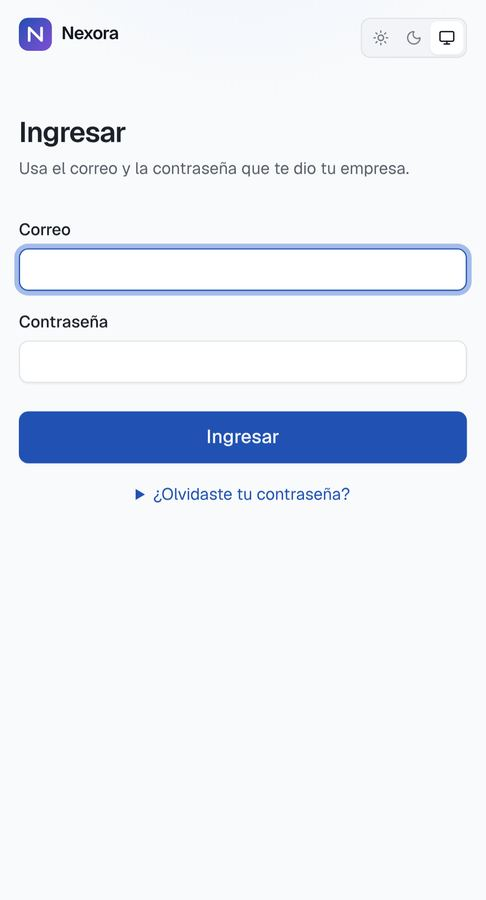

---

## 2. Empleado

### Marcar entrada y salida

1. En la entrada de la sede, **escanee el QR** con la cámara del celular. Se abre Nexora (si no tiene sesión, ingrese y volverá al QR).
2. **La primera vez:** toque **Vincular este celular**. Solo podrá marcar desde ese celular. Si ya tenía otro vinculado, el nuevo queda pendiente hasta que el administrador lo apruebe.
3. Toque **Registrar entrada** (o **Registrar salida**). El celular pide permiso de **ubicación**: debe estar dentro del área de la sede.
4. Si activó la huella, el celular le pide su huella, rostro o PIN.
5. Verá la confirmación con la hora. **La hora la pone el servidor**, no el celular.

| Antes de marcar | Entrada registrada |
|---|---|
| 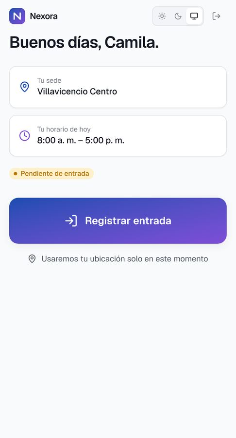 | 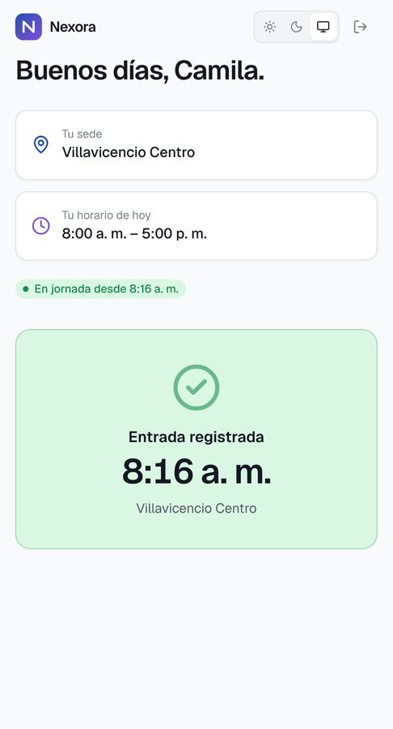 |

**Activar la huella (recomendado):** en Inicio, **Activar huella**. Así nadie más puede marcar por usted, aunque tenga su celular. Nexora no recibe su huella; la verifica el celular.

**Si Nexora le pide confirmar que es su celular** (por ejemplo, después de borrar los datos del navegador), toque **Reconocer este celular con mi huella**. No hace falta que el administrador apruebe nada.

**En iPhone:** si agregó Nexora a la pantalla de inicio antes del 2 de noviembre de 2026, bórrelo y vuelva a agregarlo desde Safari (Compartir → Agregar a inicio).

### Mensajes al marcar

| Mensaje | Qué hacer |
|---|---|
| Estás fuera del área de la sede | Acérquese a la entrada e intente de nuevo |
| La ubicación del celular no es precisa | Active el GPS y salga a un lugar despejado |
| Celular pendiente de aprobación | Pida al administrador que lo apruebe |
| Ya registraste una marcación hace un momento | No marque dos veces seguidas |

Los intentos rechazados no crean marcaciones, pero el administrador los ve.

### Historial y solicitudes

- **Historial:** sus jornadas de los últimos días, con horas trabajadas.
- **Solicitudes:** **Pedir un permiso o vacaciones** (por días o por horas), y ver **Mis horas extra** (las detecta el sistema; puede dejar un comentario). Mientras esté pendiente, puede **Retirar** una solicitud.

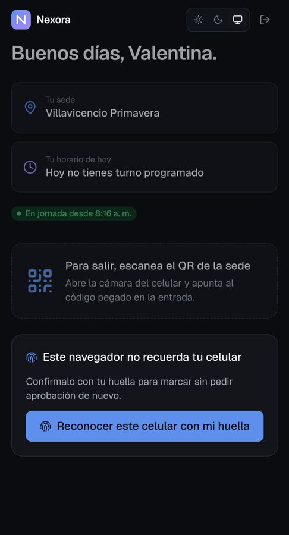

---

## 3. Administrador de la empresa

### Resumen

La asistencia de hoy (en jornada, llegadas tarde, ausentes, horas), los turnos del día y la actividad reciente.

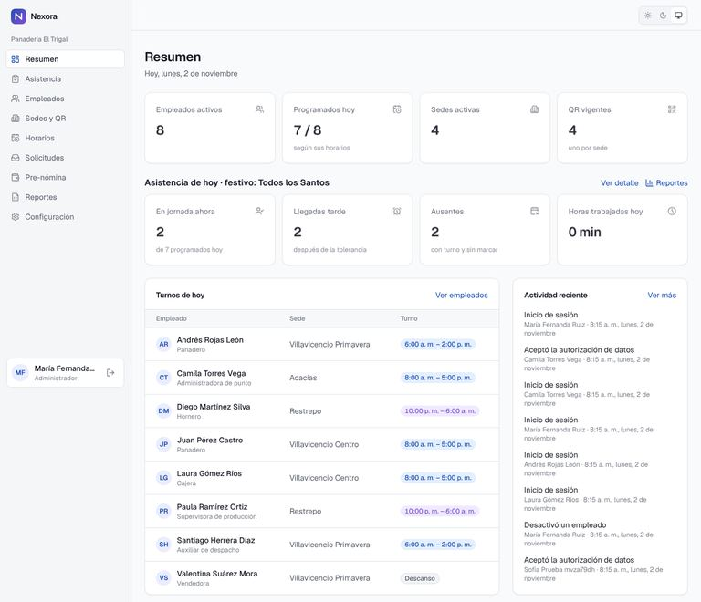

### Configuración inicial (una sola vez)

Si se registró con un link de invitación, **Primeros pasos** (en el menú) muestra qué falta y lleva a cada pantalla; cada paso se marca solo cuando está hecho.

1. **Configuración:** tolerancia de llegada tarde, precisión mínima del GPS, si se exige celular vinculado, y si la empresa aplica la **exoneración del art. 114-1 del Estatuto Tributario** (confírmelo con su contador).
2. **Sedes y QR → Nueva sede:** nombre, dirección, **coordenadas** (en la sede: Editar → **Usar mi ubicación actual**) y **radio permitido** (80 m por defecto).
3. **Imprimir QR** de cada sede y péguelo en la entrada. Si un QR se filtra o se daña: **Rotar QR** (el anterior deja de funcionar al instante; imprima el nuevo).
4. **Empleados → Nuevo empleado:** datos, sede habitual y contrato (salario, horas semanales, clase de riesgo ARL). Nexora muestra una **contraseña temporal** una sola vez: entréguesela al empleado por un canal privado.
5. **Horarios:** plantillas de turno (si el fin es antes del inicio, termina al día siguiente) y el horario de cada empleado (semanal o rotativo de 14 días). Para un día puntual: **Cambio puntual**.

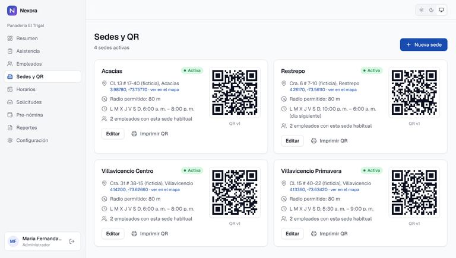

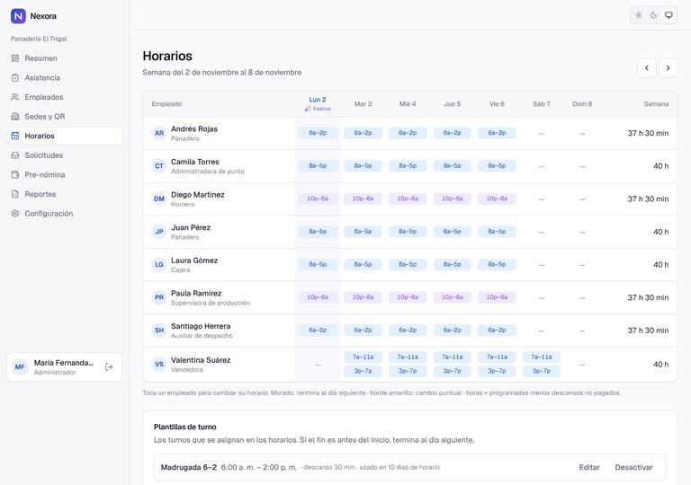

### Día a día

- **Asistencia:** quién está en jornada, quién llegó tarde o no ha llegado, intentos rechazados y celulares por aprobar.
- **Solicitudes:**
  - **Horas extra:** Nexora las detecta al cerrar cada jornada (tiempo registrado por encima del programado, desde 15 minutos). Puede **Aprobar** todo o parte, o **Rechazar**. Rechazar no borra el tiempo registrado: solo define cuánto se paga como extra. Para datos anteriores: **Revisar jornadas pasadas**.
  - **Novedades:** aprobar o rechazar permisos y vacaciones; **Registrar novedad aprobada** (por ejemplo, una incapacidad que le enviaron).
- **Correcciones** (en el detalle del empleado): registrar la salida olvidada de una jornada o **Agregar jornada**, siempre con un motivo. La marcación original no se borra.

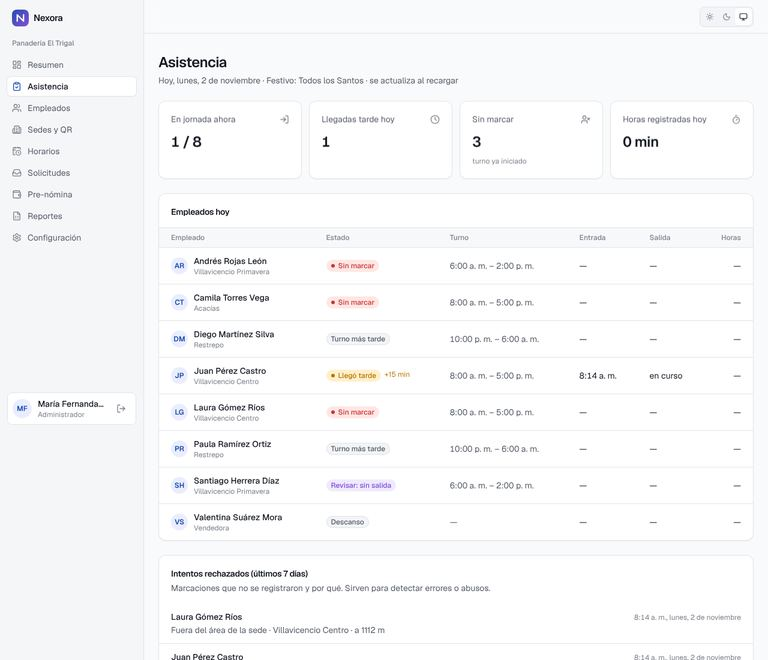

### Pre-nómina (estimación, no liquidación legal)

1. Elija la quincena o el mes y toque **Calcular estimación**.
2. Revise el total y las advertencias de cada empleado. Abra un empleado para ver cada concepto con su explicación y los parámetros legales usados.
3. Si falta un parámetro legal o un dato del contrato, ese empleado queda **Sin calcular** y no se muestra ningún valor.
4. **Parámetros laborales:** la tabla de valores legales (salario mínimo, recargos, aportes) con norma y vigencia, para revisarla con su contador.

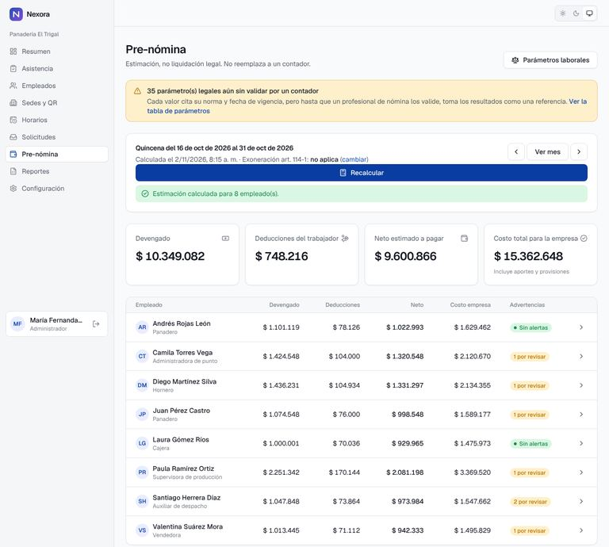

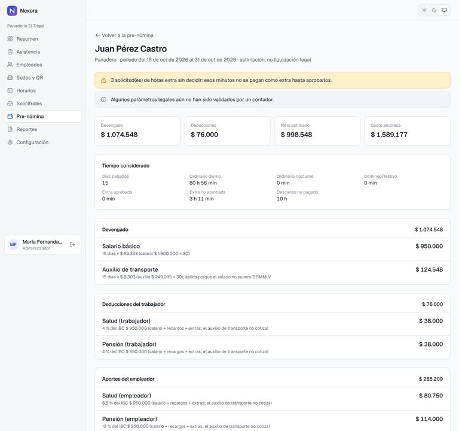

### Reportes

- Filtros por fechas, sede y empleado (con atajos: últimos 7 días, últimos 30 días, este mes, mes anterior).
- Indicadores comparados con el período anterior y gráficos (asistencia semanal, puntualidad, horas por sede, costo estimado). Cada gráfico tiene **Ver datos en tabla**.
- Cinco reportes: asistencia, horas extra, novedades, pre-nómina e intentos rechazados. Cada uno se puede **Ver** en pantalla o descargar en **Excel**, **CSV** o **PDF**, con empresa, período y fecha de generación.

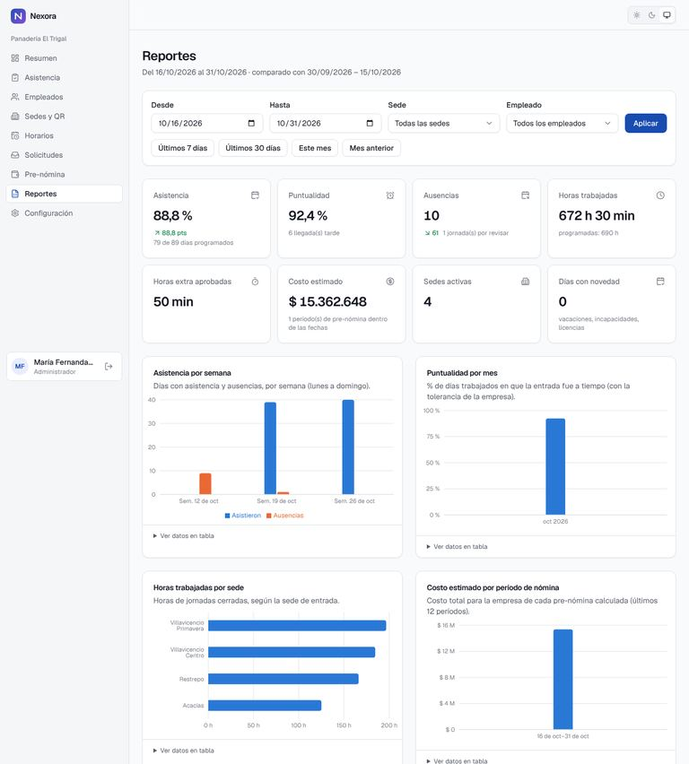

---

## 4. Superadministrador (Nexora)

- **Invitaciones → Generar link:** el dueño de un negocio abre el link, crea su empresa y su cuenta, y Nexora lo guía en **Primeros pasos** (reglas, sedes, turnos, empleados, horarios, QR y marcación de prueba). El link sirve una sola vez y vence; se puede anular.

- **Empresas → Nueva empresa:** nombre, NIT, plan y límites de sedes y empleados, y el primer administrador. Nexora muestra su contraseña temporal una sola vez.
- **Detalle de la empresa:** activar, pasar a prueba o **Suspender** (cierra al instante las sesiones de todos sus usuarios; los datos no se borran). **Restablecer contraseña** de un administrador que la olvidó.
- **Parámetros laborales:** cargar una **nueva versión** cuando cambie una norma (la anterior se cierra el día previo; nada se borra) y **Validar** cada valor después de la revisión del contador.

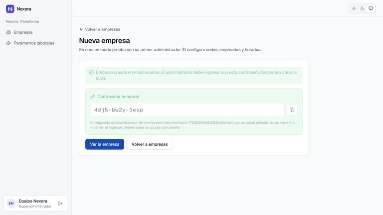

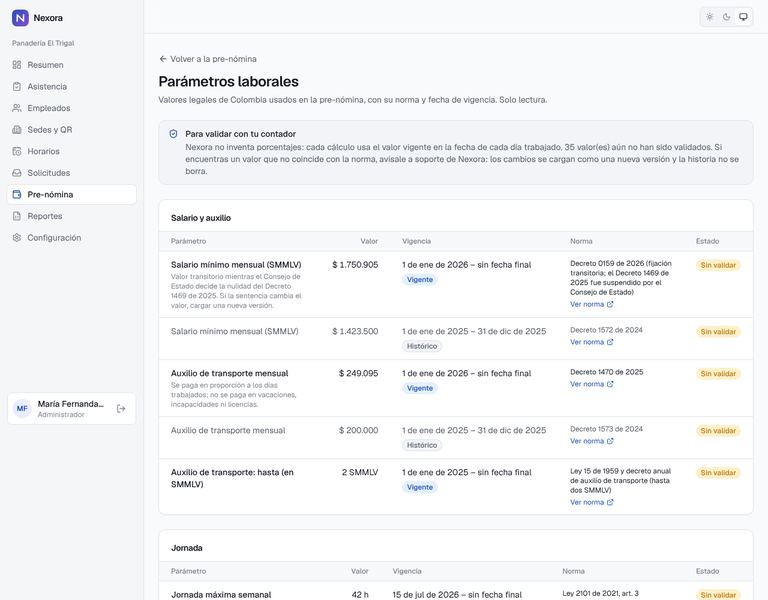
