# Manual de usuario

Nexora tiene tres tipos de cuenta:

- **Empleado:** marca su entrada y salida con el QR de su sede, y pide permisos.
- **Administrador de la empresa:** configura sedes, empleados y horarios; aprueba solicitudes; revisa asistencia, pre-nómina y reportes.
- **Superadministrador (Nexora):** da de alta empresas y mantiene los parámetros legales. No ve datos de los empleados.

Funciona en el navegador del celular o del computador, sin instalar nada. Modo claro u oscuro con el selector de la esquina superior.

---

## 0. Registrar un negocio nuevo

En la página de inicio, **Crear mi cuenta**: nombre del negocio, tu nombre, correo y contraseña. La empresa queda en modo prueba y entras directo a **Primeros pasos**. También se puede registrar con un link de invitación de Nexora.

¿Dudas antes de registrarse? El botón **¿Preguntas?** (abajo a la derecha) abre el asistente de Nexora: responde sobre precios, marcación, pre-nómina, reglas laborales y datos, y lleva al registro o al formulario de contacto.

## 1. Primer ingreso

**Empleados (sin correo ni contraseña):**
1. Abra la dirección de Nexora en su celular y escriba su **código de empleado** (por ejemplo `K7M2X-9PTQR`) en «Código de empleado» → **Entrar**. Se lo envía su empresa; no importan mayúsculas ni guion.
2. Lea y acepte la **autorización de tratamiento de datos personales**.
3. Listo: el celular queda activo de inmediato. El código es permanente; si lo olvidó, su administrador lo ve en su ficha.

**Administradores:** escriba su **correo** y la **contraseña temporal** que le entregaron, cree su propia contraseña (mínimo 10 caracteres) y acepte la autorización. ¿La olvidó? El soporte de Nexora le da una temporal nueva.

Después de 5 intentos fallidos la cuenta se bloquea 15 minutos. Si hay muchos intentos fallidos desde una misma red, esa red espera 15 minutos.

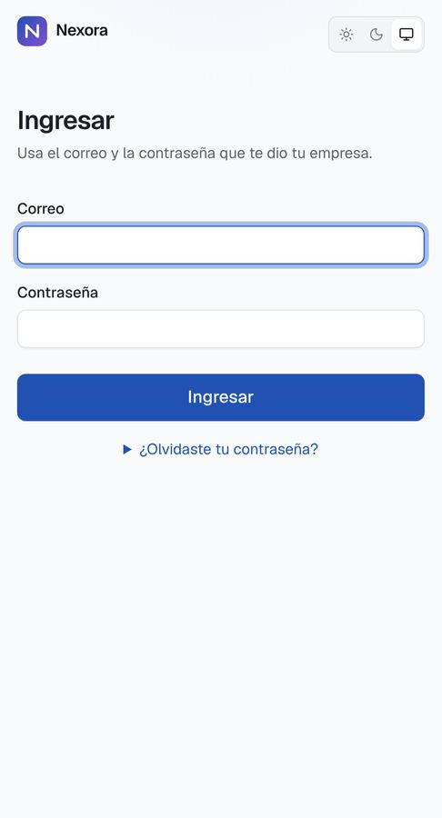

---

## 2. Empleado

### Marcar entrada y salida

1. **Solo la primera vez**, entre con su código de empleado (también puede escanear el QR de la sede: le pide el código y vuelve al QR). La sesión queda guardada en el celular (no se vuelve a pedir mientras la use).
   - **Las siguientes veces no hace falta escanear:** abra Nexora (la dirección principal lleva directo a su Inicio) y toque **Registrar entrada** o **Registrar salida**. Nexora usa la sede más cercana a su ubicación. Si el celular no lo ubica, use **¿No te ubica? Escanea el QR de la sede**.
   - **En iPhone:** si escanea con la cámara, se abre una ventana aparte; la primera vez pide **Confirmar con huella o Face ID** en esa ventana.
2. **Si su empresa le exige huella o Face ID**, toque **Activar huella o Face ID** (solo una vez por celular). Si no se la exige, Nexora se la ofrece y usted decide; una vez activada, se la pedirá al marcar. **¿Cambió de celular?** Entre con su mismo código en el nuevo: queda activo de inmediato, sin aprobaciones.
3. Toque **Registrar entrada** (o **Registrar salida**), en Inicio o en la pantalla del QR. El celular pide permiso de **ubicación**: debe estar dentro del área de la sede.
4. Si tiene la huella o Face ID activada, el celular se la pide (en algunos celulares, el PIN del celular).
5. Verá la confirmación con la hora. **La hora la pone el servidor**, no el celular.

| Antes de marcar | Entrada registrada |
|---|---|
| 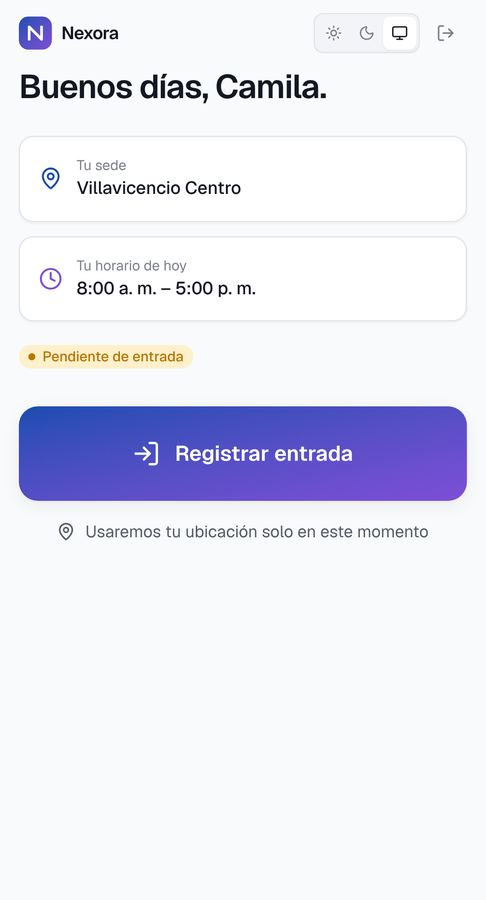 | 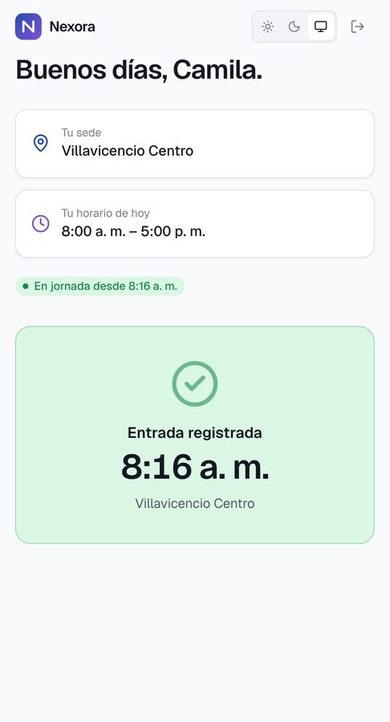 |

**Huella o Face ID:** el administrador decide, empleado por empleado, si es obligatoria. Si lo es y no la ha activado, Nexora muestra **Activar huella o Face ID** en Inicio y en la pantalla del QR y no deja marcar sin ella. Así nadie más puede marcar por usted, aunque tenga su código o su celular. Con ella también puede entrar sin escribir el código: **Entrar con Face ID o huella**. Nexora no recibe su huella ni su rostro; los verifica el celular. Si su celular no tiene huella ni Face ID, el administrador puede autorizarlo a marcar sin ella.

**Si Nexora le pide confirmar que es su celular** (por ejemplo, después de borrar los datos del navegador o al abrir el QR desde la cámara del iPhone), toque **Confirmar con huella o Face ID**. No hace falta que el administrador apruebe nada, y las demás ventanas del celular (Safari, el ícono de inicio, la cámara) siguen reconocidas: solo se confirma una vez por ventana.

**En iPhone:** si agregó Nexora a la pantalla de inicio antes del 2 de noviembre de 2026, bórrelo y vuelva a agregarlo desde Safari (Compartir → Agregar a inicio).

### Mensajes al marcar

| Mensaje | Qué hacer |
|---|---|
| Estás fuera del área de la sede | Acérquese a la entrada e intente de nuevo |
| La ubicación del celular no es precisa | Active el GPS y salga a un lugar despejado |
| Este celular ya no está activo | Entró desde otro celular más reciente: toque **Usar este celular** |
| Ya registraste una marcación hace un momento | No marque dos veces seguidas |

Los intentos rechazados no crean marcaciones, pero el administrador los ve.

### Historial y solicitudes

- **Historial:** sus jornadas de los últimos días, con horas trabajadas.
- **Solicitudes:** **Pedir un permiso o vacaciones** (por días o por horas), y ver **Mis horas extra** (las detecta el sistema; puede dejar un comentario). Mientras esté pendiente, puede **Retirar** una solicitud.

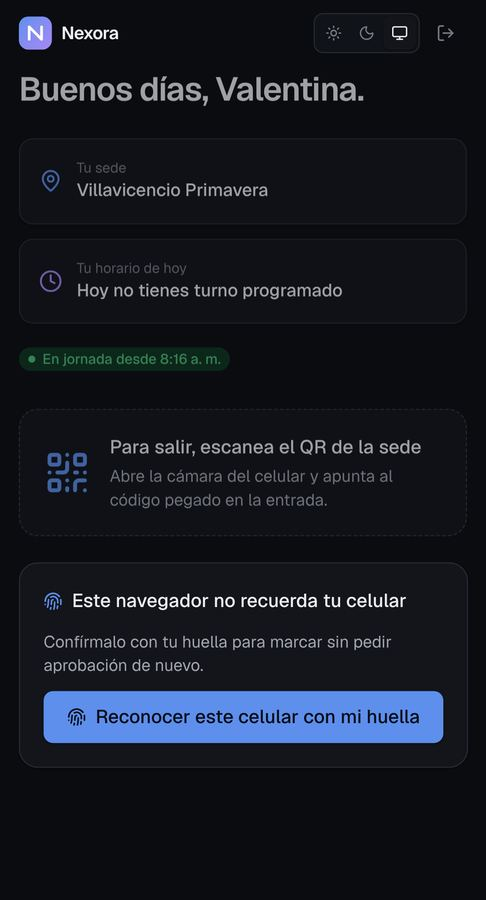

---

## 3. Administrador de la empresa

### Resumen

La asistencia de hoy (en jornada, llegadas tarde, ausentes, horas), los turnos del día y la actividad reciente.

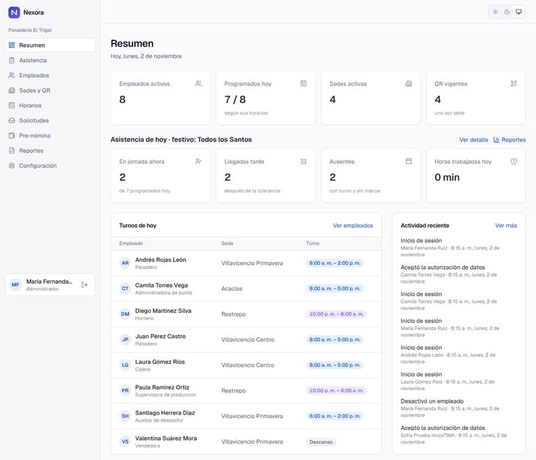

### Configuración inicial (una sola vez)

Si se registró con un link de invitación, **Primeros pasos** (en el menú) muestra qué falta y lleva a cada pantalla; cada paso se marca solo cuando está hecho.

1. **Configuración:** tolerancia de llegada tarde, precisión mínima del GPS, si se exige celular vinculado, y si la empresa aplica la **exoneración del art. 114-1 del Estatuto Tributario** (confírmelo con su contador).
2. **Sedes y QR → Nueva sede:** nombre, dirección, **coordenadas** (en la sede: Editar → **Usar mi ubicación actual**) y **radio permitido** (80 m por defecto).
3. **Imprimir QR** de cada sede y péguelo en la entrada. Si un QR se filtra o se daña: **Rotar QR** (el anterior deja de funcionar al instante; imprima el nuevo).
4. **Empleados → Nuevo empleado:** datos, sede habitual y contrato (salario, horas semanales, clase de riesgo ARL). Marque **Exigir Face ID o huella para marcar** si quiere que ese empleado la use. Nexora genera su **código de acceso**: tóquelo para copiarlo o use **Enviar por WhatsApp**. En la ficha del empleado puede verlo cuando quiera, **Cambiar código** (el anterior deja de servir, se cierran sus sesiones y se retiran sus celulares; úselo si el código se filtró) y **Exigir Face ID o huella / Hacerlo opcional**. Empleados creados antes de este cambio: en su ficha, **Generar código de acceso**.
5. **Horarios:** plantillas de turno (si el fin es antes del inicio, termina al día siguiente) y el horario de cada empleado (semanal o rotativo de 14 días). Para un día puntual: **Cambio puntual**.

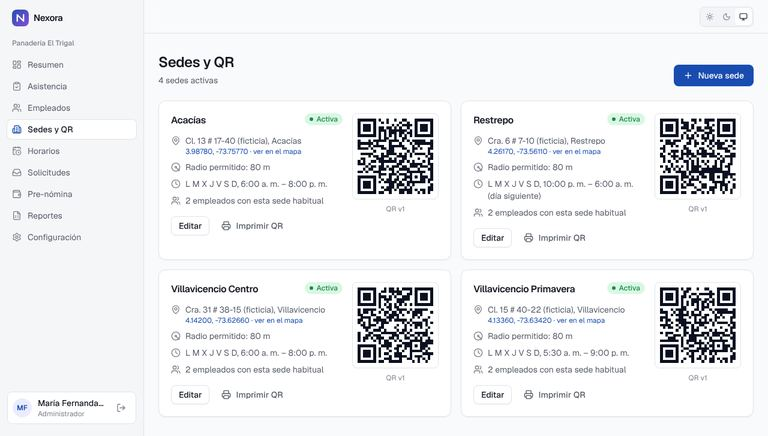

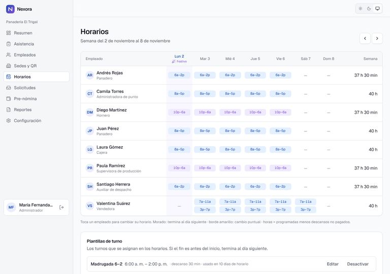

### Día a día

- **Asistencia:** quién está en jornada, quién llegó tarde o no ha llegado, intentos rechazados y celulares por aprobar.
- **Celular sin huella ni Face ID** (por ejemplo, uno viejo): en **Empleados →** el empleado **→ Celulares vinculados**, **Permitir marcar sin huella ni Face ID**. Solo aplica a ese celular; uno nuevo vuelve a exigirla. Se puede revertir con **Volver a exigir huella o Face ID**.
- **Solicitudes:**
  - **Horas extra:** Nexora las detecta al cerrar cada jornada (tiempo registrado por encima del programado, desde 15 minutos). Puede **Aprobar** todo o parte, o **Rechazar**. Rechazar no borra el tiempo registrado: solo define cuánto se paga como extra. Para datos anteriores: **Revisar jornadas pasadas**.
  - **Novedades:** aprobar o rechazar permisos y vacaciones; **Registrar novedad aprobada** (por ejemplo, una incapacidad que le enviaron).
- **Correcciones** (en el detalle del empleado): registrar la salida olvidada de una jornada o **Agregar jornada**, siempre con un motivo. La marcación original no se borra.

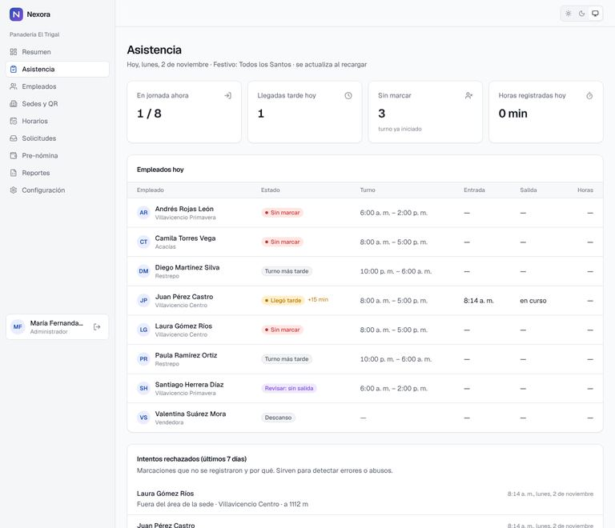

### Pre-nómina (estimación, no liquidación legal)

1. Elija la quincena o el mes y toque **Calcular estimación**.
2. Revise el total y las advertencias de cada empleado. Abra un empleado para ver cada concepto con su explicación y los parámetros legales usados.
3. Si falta un parámetro legal o un dato del contrato, ese empleado queda **Sin calcular** y no se muestra ningún valor.
4. **Parámetros laborales:** la tabla de valores legales (salario mínimo, recargos, aportes) con norma y vigencia, para revisarla con su contador.

**Liquidar el período (Calcular → Revisar → Cerrar):**

1. **Calcular:** mientras está en *Borrador* puede recalcular las veces que quiera (por ejemplo, después de aprobar horas extra o corregir una jornada).
2. **Marcar como revisada:** cuando todos los empleados quedaron calculados. Ya no se recalcula; si encuentra un error, **Volver a borrador para corregir**.
3. **Cerrar período:** marque la casilla de confirmación (el contador revisó los valores) y toque **Cerrar período**. Un período cerrado queda fijo: no se recalcula ni se reabre.

En **Liquidación del período** ve cuánto sale y a quién: neto a pagar a los empleados, planilla de seguridad social (PILA) y provisiones para reservar (cesantías, intereses, prima y vacaciones), más el total por concepto. Los tres suman el costo total para la empresa.

**Descargas:** **Comprobantes de pago (PDF)** (una página por empleado, con firma del empleador y «recibí conforme»; dice *BORRADOR* hasta cerrar el período), el comprobante de un solo empleado desde su detalle, y **Resumen para el contador (Excel)**. **Períodos calculados** muestra el estado de cada quincena o mes y el **Historial** quién calculó, revisó y cerró, y cuándo.

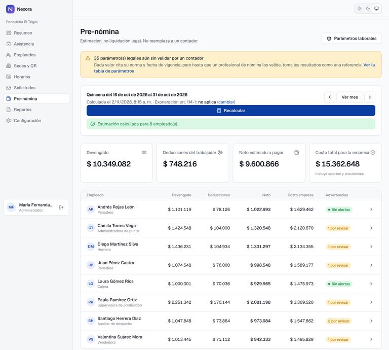

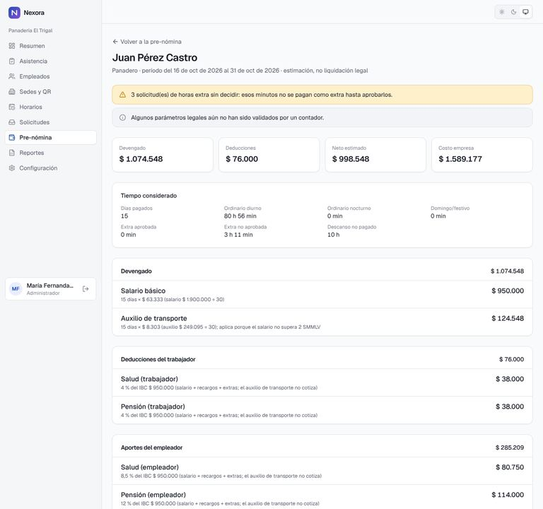

### CRM

- **Embudo:** oportunidades por etapa (Nuevo, Contactado, Propuesta, Negociación, Ganado, Perdido) con su valor. Cambia la etapa desde la tarjeta; **Perdido** pide el motivo. Arriba: valor abierto, tasa de cierre de 30 días y tareas pendientes.
- **Clientes:** búsqueda por nombre, celular, correo o documento y filtro por origen (manual, venta, Facebook/Instagram, WhatsApp, TikTok, web). En la ficha: llamar, abrir WhatsApp, oportunidades, **seguimientos** (nota, llamada, WhatsApp, correo, reunión) y **tareas con fecha**, que aparecen en el CRM hasta marcarlas **Hecha**.
- **Autorización comercial (Ley 1581):** marca si el cliente aceptó recibir promociones; queda la fecha y el origen. Sin ella no le envíes publicidad.
- **Leads automáticos** (Integraciones):
  - **Facebook e Instagram:** en la tarjeta de Meta aparecen la URL privada y el token de verificación. En tu app de Meta → Webhooks → Page, pégalos y suscribe «leadgen». Cada formulario de anuncio crea el cliente y una oportunidad.
  - **WhatsApp:** igual, en WhatsApp → Configuración → Webhook, suscribiendo «messages». Cada mensaje queda en el historial del cliente. Requiere la clave secreta de la app.
  - **TikTok y formularios web:** activa «Entrada de leads» y envía a su URL privada un JSON con name, phone, email, message, campaign y source (TIKTOK o WEB), por ejemplo desde Zapier o Make.
  - El cliente se reconoce por celular o correo (no se duplica) y el mismo aviso nunca se registra dos veces.

### Mensajes (WhatsApp, Messenger e Instagram)

En **Mensajes** están todas las conversaciones, unidas a la ficha de cada cliente (como en el CRM de Ámbar Couture).

- **Chats:** la lista muestra el canal, los mensajes sin leer, la etiqueta de la IA y si el chat **debe atenderlo una persona**. Al abrir uno ves la conversación, el estado de cada mensaje enviado (✓ enviado, ✓✓ entregado, leído) y quién lo escribió (tú, la IA o desde el celular).
- **Responder:** escribe abajo y toca enviar (Enter envía; Mayús+Enter, nueva línea). Meta solo deja responder libremente **hasta 24 horas después del último mensaje del cliente**; pasado ese tiempo, en WhatsApp se usa una **plantilla aprobada**.
- **IA de mensajes:** con tu llave de Claude (Integraciones), la IA lee cada mensaje nuevo con lo que sabe de tu negocio, tus productos, precios, stock y sedes:
  - **Sugerir:** deja la respuesta lista; tú la revisas con «Usar la respuesta de la IA» y la envías.
  - **Responder sola:** la envía al instante, salvo reclamos, pagos, excepciones o cuando el cliente pide una persona (esos chats quedan marcados). Puedes **pausar la IA** en un chat.
  - **Lo que le falta a la IA:** las preguntas que no pudo responder por falta de un dato. Respóndelas una vez y se agregan a lo que sabe.
  - Nunca inventa precios, existencias ni políticas: si no lo sabe, dice que lo confirma.
- **Plantillas de WhatsApp:** escribe la plantilla (con variables {{1}}, {{2}}… y su ejemplo), **Enviar a Meta** y espera la aprobación (el estado se actualiza solo o con «Sincronizar con Meta»). Aprobada, aparece en los chats de más de 24 h para retomarlos.
- **Avisos:** arriba de los chats ves cuántos chats piden una persona, cuántos llegaron hoy por anuncios (y desde cuál), los comentarios de redes por responder y los datos que le faltan a la IA. En el menú, **Mensajes** muestra el número de pendientes.
- **De qué anuncio llegó:** si el cliente tocó «Enviar mensaje» o el botón de WhatsApp de un anuncio o publicación de Facebook o Instagram, el chat lo muestra («Llegó por un anuncio: …», con **Ver anuncio**) y la oportunidad del CRM se llama como el anuncio. El filtro **Llegaron por anuncios** los reúne.
- **IA en el chat:** **IA activa · Pausar** en el encabezado de cada chat; **Respuesta automática de la IA: Encender/Apagar** para todos los chats; **Marcar resuelto** cuando ya atendiste un chat que pedía una persona.
- **Comentarios de redes:** comentarios de tus publicaciones y anuncios de Facebook e Instagram, clasificados por la IA (interés, elogio, queja) con su respuesta sugerida. **Responder en público**, **Responder por privado** (abre el chat en Chats; Meta lo permite dentro de 7 días) o **No responder**. En tu app de Meta suscribe los campos **feed** (página) y **comments** (Instagram).
- **Anuncios:** chats, clientes, ventas ganadas y valor que trajo cada anuncio en las fechas que elijas; toca uno para ver sus chats.
- **Agenda con botones:** en un chat, **Agendar cita → Enviar horarios con botones**: el cliente toca el día y luego la hora (en WhatsApp, botones y lista; en Messenger e Instagram, respuestas rápidas) y la cita queda creada con su confirmación, sin que nadie escriba. Con la respuesta automática encendida, la IA los ofrece sola cuando el cliente quiere agendar. También puedes elegir un horario libre y **Agendar** tú. Los horarios salen del horario de atención de la sede (si no tiene, lunes a sábado de 8 a. m. a 6 p. m.); la duración y las citas a la misma hora se ajustan en **IA de mensajes → Agenda por botones**.
- **Agenda (menú):** las citas por día, de dónde salieron (botones del chat, la IA o a mano) y **Confirmar / Asistió / No asistió / Cancelar**. En **Anuncios** se ve cuántas citas trajo cada anuncio.
- **Aprendizaje diario de la IA:** cada mañana (7:40 a. m.) la IA revisa los chats de los últimos 7 días, compara los que terminaron en cita o venta con los que no y ajusta sola sus conocimientos e instrucciones. En **IA de mensajes** ves el último informe con cada cambio (antes y después), **Aprende sola: ENCENDIDO/APAGADO**, **Analizar la semana ahora** y el **Historial de versiones** con **Volver a esta**. Sin llave de Claude hace un informe con reglas simples.
- **Demostración:** **Ver demostración** carga chats (varios llegados por anuncios), comentarios y el análisis de la IA para mostrar el CRM sin conectar nada. En esos chats puedes **escribir como el cliente** para ver a la IA sugerir o responder sola. Nada sale a ninguna plataforma; **Borrar demostración** lo quita todo.
- **Conectar:** en Integraciones, WhatsApp (con la clave secreta de la app) y Facebook e Instagram. En tu app de Meta suscribe «messages» (WhatsApp y página) y, para plantillas, «message_template_status_update».

### Ventas

1. **Nueva venta:** elige la sede, busca los productos por nombre o código y tócalos para agregarlos (Enter agrega el primero). Ajusta cantidades y descuentos; el total con IVA se calcula en vivo. Si no hay stock suficiente en la sede, el renglón se marca y no deja registrar.
2. **Cliente:** consumidor final, uno existente o uno nuevo (con documento, la siguiente vez se reconoce).
3. **Registrar venta:** recibe un número consecutivo (V-000001, V-000002…), descuenta el inventario de la sede y el valor entra a la caja de hoy con su medio de pago. La caja del día debe estar abierta.
4. **Comprobante (PDF):** soporte interno de la venta. La factura electrónica ante la DIAN se emite con tu facturador (Siigo o Alegra); su envío automático se activa al conectar la cuenta en Integraciones.
5. **Anular venta:** con motivo; devuelve los productos al inventario y anula el ingreso de caja. El número no se reutiliza.

### Inventario

- **Nuevo producto:** código (SKU, único en tu empresa), nombre, categoría, unidad, precio de venta antes de IVA, IVA (0, 5 o 19 %), costo y stock mínimo. Un **servicio** no lleva inventario.
- En la ficha del producto, **Registrar movimiento**:
  - **Entrada** (compra, producción). Si escribes el costo unitario, queda como costo del producto.
  - **Salida** (consumo, daño, pérdida). No deja sacar más de lo que hay en la sede.
  - **Ajuste por conteo físico:** escribe lo que contaste; Nexora registra la diferencia.
  - **Traslado entre sedes:** sale de una sede y entra a la otra en un solo paso.
- Cada movimiento queda con fecha, sede, motivo y quién lo hizo, y **no se puede editar ni borrar**: un error se corrige con otro movimiento.
- La lista muestra el stock total o por sede, el valor del inventario a costo y los productos **en o bajo el mínimo**. Un producto desactivado deja de aparecer y no se puede mover.

### Caja

1. Elige la **sede** y el **día** (por defecto hoy).
2. **Registrar movimiento:** ingreso o egreso, valor, medio de pago (efectivo, transferencia, tarjeta u otro), categoría y detalle.
3. Un error se **anula** con motivo: queda tachado y sale de los totales. Ningún movimiento se borra.
4. **Cerrar el día:** escribe el efectivo contado. Nexora lo compara con el **esperado** (saldo inicial + ingresos − egresos en efectivo) y muestra si sobra o falta. Si no cuadra, hay que explicar la diferencia.
5. Con el día cerrado no se registra ni se anula nada. Para corregir, **Reabrir el día** con un motivo (solo el último día cerrado de la sede). El saldo inicial de cada día es el efectivo contado en el cierre anterior.

### Integraciones

Conecta las cuentas de tu negocio en **Integraciones**: Facebook e Instagram, TikTok for Business, WhatsApp Business, facturación electrónica (Siigo **o** Alegra, uno a la vez), correo (Resend) y la llave de Claude.

1. Abre **¿Dónde consigo estos datos?** en la tarjeta de la plataforma y sigue los pasos.
2. Pega los datos y toca **Guardar**. Los tokens se guardan cifrados y **nunca se vuelven a mostrar**: para cambiar uno, escribe el nuevo; si dejas el campo vacío se conserva el guardado.
3. Toca **Probar conexión**: Nexora consulta la plataforma y muestra **Conectada** (con el nombre de tu página, cuenta o número) o **Con error** y el motivo.
4. **Desconectar** borra los datos y tokens guardados.

### Reportes

- Filtros por fechas, sede y empleado (con atajos: últimos 7 días, últimos 30 días, este mes, mes anterior).
- Indicadores comparados con el período anterior y gráficos (asistencia semanal, puntualidad, horas por sede, costo estimado). Cada gráfico tiene **Ver datos en tabla**.
- Cinco reportes: asistencia, horas extra, novedades, pre-nómina e intentos rechazados. Cada uno se puede **Ver** en pantalla o descargar en **Excel**, **CSV** o **PDF**, con empresa, período y fecha de generación.

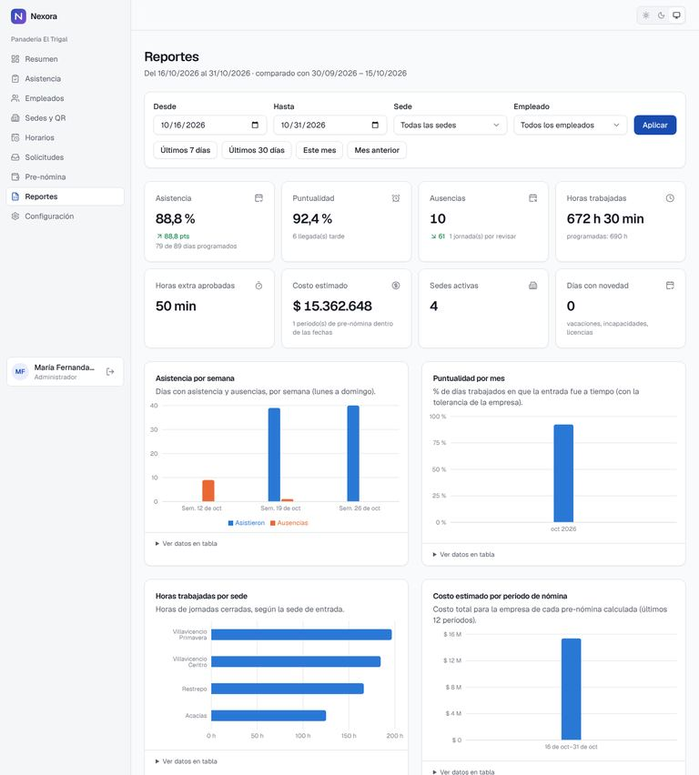

---

## 4. Superadministrador (Nexora)

- **Solicitudes:** los negocios que llenan «Solicita tu invitación» en la página de inicio. Contáctalos, genera su link en **Invitaciones** y márcalos como contactados, invitados o descartados.

- **Invitaciones → Generar link:** el dueño de un negocio abre el link, crea su empresa y su cuenta, y Nexora lo guía en **Primeros pasos** (reglas, sedes, turnos, empleados, horarios, QR y marcación de prueba). El link sirve una sola vez y vence; se puede anular.

- **Empresas → Nueva empresa:** nombre, NIT, plan y límites de sedes y empleados, y el primer administrador. Nexora muestra su contraseña temporal una sola vez.
- **Detalle de la empresa:** activar, pasar a prueba o **Suspender** (cierra al instante las sesiones de todos sus usuarios; los datos no se borran). **Restablecer contraseña** de un administrador que la olvidó.
- **Integraciones:** la llave de Claude que usa el asistente de la página de inicio de Nexora (si no hay, se usa la variable `ANTHROPIC_API_KEY`).
- **Parámetros laborales:** cargar una **nueva versión** cuando cambie una norma (la anterior se cierra el día previo; nada se borra) y **Validar** cada valor después de la revisión del contador.

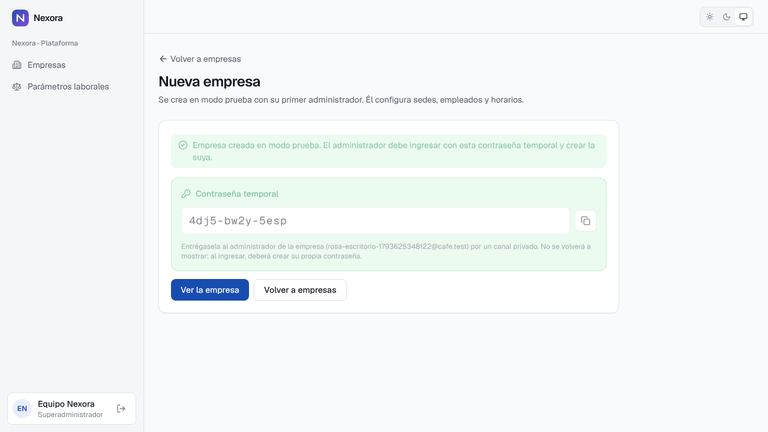

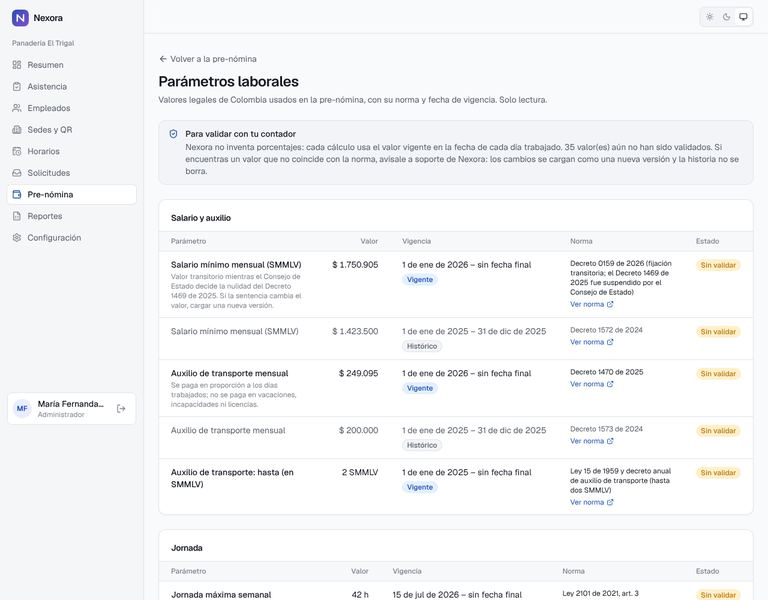
